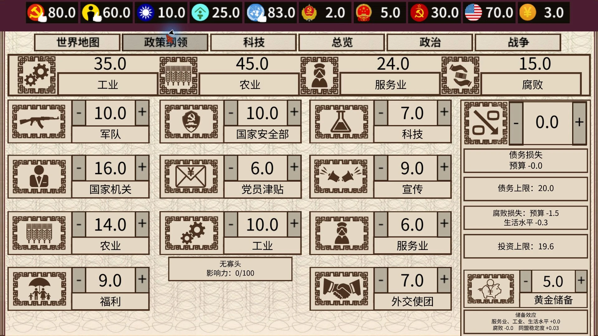

# 《中国：毛的遗产》简体中文补丁

适用于 Windows 版 Steam 构建 **21377206**。本项目独立提供这款游戏的中文文本校订、字体补丁和安装器。[下载 Windows 版](https://github.com/lingjieheti/china-maos-legacy-zh-cn/releases/latest) · [本次文本校对报告](games/mao/AUDIT.md)

本次修正了新疆结局与人物对应错误，分清华约和经互会两项条件，并恢复国策与事件脚本使用的内部键。玩家在界面上仍看到中文标题。

## 安装与更新

1. 在 Steam 安装游戏，登录拥有该游戏的账号，然后退出游戏。
2. 安装 Windows **64 位 Python 3.12**，下载 Release 中以 `-Windows.zip` 结尾的文件并完整解压。[Python 官方下载](https://www.python.org/downloads/windows/)
3. 双击 **汉化管理.cmd**，选择 **安装或更新**。完成后从 Steam 启动游戏。再次打开管理器，可以核验已安装的文件或还原。

中文使用游戏的 English 语言槽。如原来选用俄文，可在语言选择页点击英国旗帜。首次安装会下载固定版本的社区翻译和构建工具。

高级用法、备份位置、上游译者署名与字体授权见[安装与来源说明](games/mao/README.md)。也可在解压目录打开终端运行：

```powershell
py -3.12 manage.py install
py -3.12 manage.py verify
py -3.12 manage.py restore
```

## 实机画面

下图记录 Windows 实机检查的经济面板。文本校对的范围、此次修订及仍待验证的内容见[校对报告](games/mao/AUDIT.md)。


