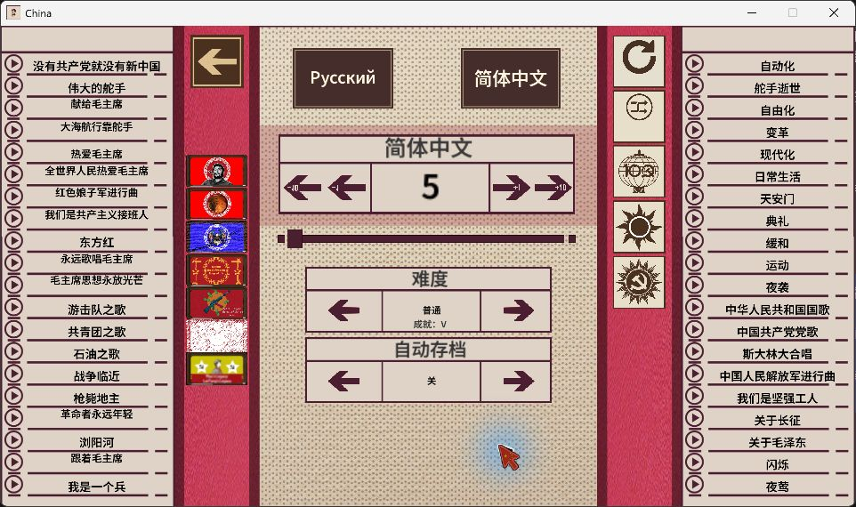

# 1.2.1 社区反馈与回归记录

适配 Steam Windows Build 21377206。以下对比使用 1.2.0 的实际安装副本与同一 Steam Build 的原件。

## 语言入口

玩家曾向社区汉化作者求助，覆盖补丁后仍找不到中文选项。1.2.0 的设置页会显示当前语言，但切换语言的两个按钮仍只画国旗。1.2.1 把语言名称直接写在按钮上。从主菜单打开“设置”（Настройки），点击右侧的“简体中文”或左侧的“Русский”，再按左上角箭头返回。另一个独立语言选择场景的普通与悬停贴图也使用这两个标签。[玩家反馈及作者回复](https://github.com/LeXwDeX/Mao-s-Legacy-Chinese-Tools/issues/1)

在 Steam 版的游戏窗口中，点左侧按钮后当前语言显示“Русский”，再点右侧后显示“简体中文”。返回主菜单可见“设置”“读取存档”“游戏规则”“新游戏”等中文入口。设置页的音乐列表还有五个曲名原本挤成两行，例如“大海航行靠舵手”和“毛主席思想永放光芒”。本次移除多余换行，1920 × 1080 窗口实测这五项均可在一行读完。

## 存档和读档详情

上游维护者曾记录难度、成就词条夹杂英文及第一行粘连。1.2.0 的两套详情方法已经使用中文并保留换行。本次复查发现，俄文“Госстрой”对应的政体被写成“系统”，“可用”和“不可用”同用红色，游戏日期采用日、月、年顺序。[上游修复与复现说明](https://github.com/LeXwDeX/Mao-s-Legacy-Chinese-Tools/pull/5)

1.2.1 的中文存档和读档详情都显示“政体”。成就可用时显示浅绿的“可解锁”，禁用时显示红色的“不可用”。游戏内日期按年、月、日排列。例如 1977 年 11 月 4 日显示为 `1977-11-4`，俄语详情仍显示 `4.11.1977`。此处改动只涉及详情显示，读取的存档字段及文件格式保持兼容。

## 核验与还原

本地测试发现，1.2.0 的同目录安装在丢失一个原件备份后仍报告核验通过。1.2.1 同时核对已安装文件和对应原件备份。完整旧版会提示点击“安装汉化”升级，已损坏的文件会优先显示具体文件名。修复备份时只接受与支持版本指纹相符的 Steam 原件。旧版仍可直接还原，升级时会额外备份语言按钮所在的资源文件。

## 已做的验证

- 在完整的 1.2.0 独立副本上测试了离线升级、核验与还原。游戏文件清单包含 30 个 Steam 原件和一个辅助程序集。还原时已逐文件比对原件指纹并移除辅助程序集。
- 从设置场景的两个按钮出发，按精灵引用读回两张实际使用的 224 × 136 像素纹理，核验字形和四边留白。另从独立语言选择场景的资源读回四张普通、悬停贴图。六张纹理分别位于两个资源文件，其他精灵、边框、背景及引用都与原件一致。
- 从最终生成的程序集读取两个存读档详情方法，验证中俄日期字段顺序、分隔符、政体文案和成就状态颜色。构建同时核对全部 3,511 个原方法和 478,612 条原始指令。此次未用玩家存档实机走遍各剧情。
- 在仓库根目录运行 `python -B -X utf8 games/mao/test_community_121.py -v`，可复查旧版提示、受损文件、缺少备份、升级、还原及收据错配。设置环境变量 `MAO_TEST_GAME` 指向已装 1.2.1 的独立游戏副本，并安装 UnityPy 1.25.4，还可回读设置页引用链、两套按钮的字形和留白，以及全部 40 个歌名的单行格式。

## 其他玩家反馈

- Steam 玩家曾在另一款 Linux 补丁下遇到悬停生活水平后两周变化值消失。本项目此前已在 Windows 实机看到两周变化值；1.2.1 沿用该表现。Linux 版本的同类反馈仍须在 Linux 上独立验证。[Steam 讨论](https://steamcommunity.com/app/950740/discussions/0/571542958702280330/)
- 有玩家报告覆盖另一个社区补丁后，“游玩”按钮没有反应。反馈未给出可复核的完整本机文件指纹。在本项目此前对 Build 21377206 的 Windows 实机测试中，已从启动设置进入地图与经济界面。目前不能由此确定该玩家环境中的原因。[上游问题 #8](https://github.com/LeXwDeX/Mao-s-Legacy-Chinese-Tools/issues/8)
