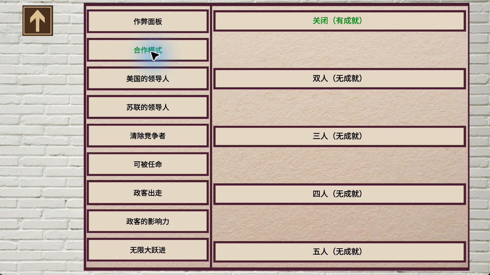

# 公民档案与结局文本复查

适用于 Windows Steam 构建 21377206，游戏内版本 1.8.5。本轮复查发现，v1.2.2 在普通事件中已显示中文，但另有一套公民档案界面和结局报表仍从英文数组取词。

## 玩家可见的改动

- 《雷锋的遗产》的公民创建页补全 38 项界面文字和 12 个职业选项。姓名输入提示、年龄、政治立场、可用点数和公民追踪均使用简体中文。农民和农场主、服刑人员和获赦人员分别对应不同选项。
- 三份公民结局报表共用的姓名、出生及死亡日期、职业经历、子女数、性格特质和生平记录均已汉化。没有相应特质时，中文显示“无”，俄文仍显示原词。公民管理页采用相同的特质译名。
- 基础游戏的两个失败结局标题由 Uprising、Genocide 改为“人民起义”“种族灭绝”。
- 源码安装首次准备 UnityPy 后，父进程释放游戏文件锁，再由准备好的 Python 继续安装。这修复了首次安装可能误报“另一个汉化操作正在进行”的问题。

开发者说明《雷锋的遗产》加入了可创建和追踪的公民。测试账户未安装这项扩展，公民界面和三份结局的核验范围是构建产物与显示逻辑，未在付费剧情中触发结局。[《雷锋的遗产》Steam 页面](https://store.steampowered.com/app/3570030/)

## 验证

从汉化后的场景重新读取公民页，核对全部 42 个界面槽位和 12 个职业槽位。38 个非空界面槽和全部职业选项均含汉字，4 个原有空槽保留。俄语字段、42 个文字控件引用及尾部状态与 Steam 原件逐字节相同。两个失败结局标题及三份档案的显示位置另在程序集构建时按原方法、原字符串和位置核对。

另用同一 Steam 账户在正式安装目录做了原版与 v1.2.3 的对照。两次均从 Steam 启动，可进入已安装的《生活之路》（Ways of Life）的“游戏规则 → 合作模式”。原版和中文版都显示九类规则以及关闭、双人、三人、四人、五人五个选项，默认选中项一致。此次未更改规则或推进游戏。两张截图均为 1920 × 1080，可点击查看原尺寸。[开发者对游戏规则和合作玩法的说明](https://store.steampowered.com/app/1841880/)

| Steam 原版 | v1.2.3 简体中文 |
| --- | --- |
|  |  |

源码回归可从仓库目录运行 `python -B -X utf8 -m unittest discover -s games/mao -p "test_*.py"`。设置 `MAO_TEST_GAME` 为已汉化的游戏目录、`MAO_TEST_ORIGINAL` 为本机原件备份目录，可额外检查实际场景。设置 `MAO_LAYOUT_STAGE` 为生成后的 `China_Data` 目录，可运行排版回读检查。
