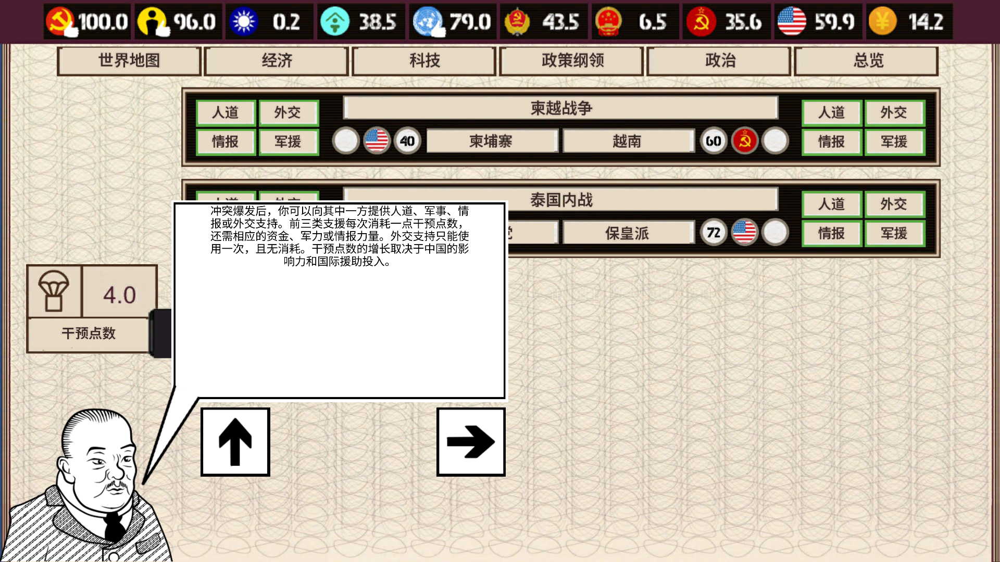

# v1.2.4 文本与教程复查

在 Steam Windows 版 1.8.5（Build 21377206）上，从英文、俄文原件、固定版本的社区底包和 v1.2.3 实际安装结果重新对照。以下统计来自生成后的玩家资源，代码索引均从 0 开始。

## 玩家实际看到的改动

| 界面 | 本版校订与依据 |
| --- | --- |
| 法国事件 | 原俄版事件表有 1,710 行，英文和旧中文版在第 1,664 行结束。补齐 `Events_text[1664..1709]` 共 46 行，包括希拉克与巴尔的去留、对北京局势的反应、阿尔及利亚公投、国内结盟、萨法里俱乐部、经济危机六起事件的标题、说明、选择及结果。原游戏 `Event437` 至 `Event442` 在运行中读取的索引恰好覆盖这 46 行。 |
| 外交行动 | 原英文外交表中，第 486–489 项原供中国界面读取，法、苏剧本也用相同位置读取外交声望与贸易。第 490–563 项则在英文中留空。按俄语表补齐 77 项，保留一项内部区段标记为空，并将中国侧栏的 7 次读取指向原俄版已有的 560–563 四个对应位置。声望的比较符和数值继续由游戏传入。 |
| 中国外交与国策 | 区分经济联盟、集体安全联盟和美国中央情报局。德国统一按钮交代由东德主导；西德是否加入北约及欧洲经济共同体、与美苏的关系是否均达到 90.0 等条件按实际判断显示。利比亚的战争条件明确为与乍得之间当前没有战争。修订发射场事件的选项「建成太原发射场」，并区分「党际联系」「右倾程度」与外交结盟。 |
| 经济修正 | 原中文版已翻译各经济制度的段落，但悬停窗口仍用英文字段查找段落，找不到时直接显示静态原文。现在可显示当前经济模式并将未激活的段落变灰。对修正项 59 的真实显示方法运行计划、自动化计划、国家垄断资本主义、鸟笼经济、混合经济及最低监管六种模式，中文与俄语分别运行一次。 |
| 结局、公民与科研 | 补译两段中国政局结局、计算机化方案、周恩来逝世后不同路线的事件结果等。中共历史决议恢复「七分功绩、三分过失」的路线。公民页三组操作的资助、特赦和政治追查及姓名提示均有中文，追查根据人物处境可能导致转入地下或入狱。提前研究的额外预算与正常研究费用分开说明。 |
| 内置教程 | 校订 31 段讲解，在英语槽的 22 张操作截图中排入中文标签。分别检查面板、按钮、资源名称和弹窗信息，共 595 处。独立运行游戏的教程场景，依次切过全部 31 步，核对 22 张图。正式安装器的贴图流只在指定字框所在压缩块发生变化，俄语截图和其余区块均与原件一致。 |

实际教程窗口（1920 × 1080）。本页列出战争干预的选项及其代价，点击可查看原尺寸。

[](../../docs/tutorial-zh.webp)

## 审查范围

- 对 26 个游戏场景及其共享资源、总资源表和全局资源表共 **54 个 Unity 容器**枚举对象。原件包含 **73 个 TextAsset**、762 个有内容的 TextMesh 和 867 张 Texture2D。资源、事件读表脚本、场景组件及程序集中的内容分别检查。OCR 覆盖这 867 张嵌入纹理，照片、签名、国旗、美术原画上的文字保留原貌。
- 24 张中文资源表合计 **4,472 个物理行**。包括 1,710 行事件正文及结果、1,098 行决策和通用文本、598 行外交等提示、350 行国策脚本、69 行事件脚本，以及国家、人物、派别、特质、修正项和学说等资料。五张以分号或冒号存储的表另拆为 134 个字段对齐；脚本保留事件和国策的内部名称、图标与格式标记。
- 比较四套文本的行数、占位符、脚本索引、数字、角色与国家、条件、近义或重复译文、字体与富文本。人工核实检索筛出的高风险句、缺段和控件调用关系。原版个别表只提供俄语对应项，还有一份脚本只有英文。自动比对覆盖全表，人工审读和实机验收的范围见上方各项。
- 相对 v1.2.3 的最终资源，**188 行**发生变化，包括 `Events_text` 57 行、`new_event_text` 2 行、`new_texts` 38 行、`other_text` 91 行。另有 11 个游戏方法中的 **52 处**文字引用、31 段教程、10 处公民操作提示和 22 张教程截图。整张资源表中的 1,045 处占位符逐项对上原件。汉字所在程序集字串和资源表共使用 2,679 个可打印字符，常规、半粗两种字体均可显示。
- 原程序集共 811 个方法含字符串加载，总计 10,049 处。审查时辨认调试日志、对象与资源查找名、存档标识和俄语槽。致谢页中的作者署名和创作者账号照录原件。构建器另逐条核对 3,511 个原方法的 478,612 条原指令。
- 现有构建自带多个 DLC 的文本和脚本，本轮连同基础游戏一起作静态核查。法国六起事件按对应脚本取值，没有逐一游玩触发。苏联国家编号为 7；原件的 `Part7` 首字段仍写作中国编号 1，后续内容与 `Part1` 重复。主菜单里原版可切换国家的两个箭头在默认关闭的父节点下，本轮没有确认正常开局可以进入苏联党派界面。这份模板维持原有派别用词。

## 在自己的游戏原件上复核

维护所用的 Python 依赖包括 UnityPy、dnfile、dncil。以下 PowerShell 命令分别输出资源范围、四套文字的查验报告，并运行回归。将变量设为自己的目录。游戏原件备份和社区缓存位置见[安装说明](README.md)。

```powershell
$gameData = "D:\SteamLibrary\steamapps\common\Mao's Legacy\China_Data"
$stock = Join-Path (Split-Path $gameData) ".nostalgames-zh-cn\backup\original"
$community = Join-Path $env:LOCALAPPDATA "Nostalgames-ZhCN\Mao\1.8.5_output"
python -B -X utf8 games/mao/audit_sources.py --game-data $gameData --original $stock --json sources.json
python -B -X utf8 games/mao/audit_text.py --original $stock --community $community --localized $gameData --check-assembly --check-fonts --json audit.json
$env:MAO_TEST_STAGE = $gameData
$env:MAO_TEST_GAME = Split-Path $gameData
$env:MAO_TEST_ORIGINAL = $stock
$env:MAO_LAYOUT_STAGE = $gameData
python -B -X utf8 -m unittest discover -s games/mao -p "test_*.py"
```

完整报告还会列出数字写法、分行、强调标记和纯拉丁字母行的差异，便于继续查阅。游戏会把正负号、年份和技术标识与中文一起显示，需结合对应调用位置核实。
